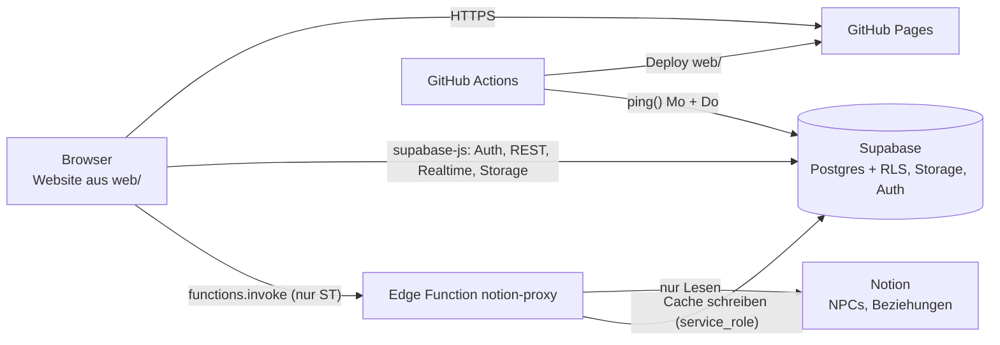

# Kiel by Night · Technische Dokumentation

Stand: 12.11.2026 · gilt für Website-Version 1.15.0 (siehe `CHANGELOG.md`)

Dieses Dokument ist ein **lebendes Dokument**. Es wird bei jeder Änderung an Funktionen, Rechten, Datenbank, Edge Function oder Betrieb mitgepflegt. Jede Änderung steht unten in der Änderungsliste. Die Bedienung beschreibt das [Benutzerhandbuch](Benutzerhandbuch.md).

## 1. Überblick

Chronik-Website für die VTM-V5-Chronik „Kiel by Night“. Es gibt zwei Rollen: **Storyteller (ST)** und **Spieler**. Die Seite ist statisch (kein Build-Schritt) und läuft auf GitHub Pages. Login, Daten, Dateien und Realtime liefert Supabase. Die NPCs und Beziehungen der Chronik liegen in Notion und werden nur für den ST über eine Edge Function gelesen.



| Baustein | Wert |
|---|---|
| Website | https://luciusgr.github.io/kiel-by-night/ |
| Repository (öffentlich) | https://github.com/LuciusGR/kiel-by-night (Branch `main`) |
| Supabase-Projekt | Ref `ueiqslwzpjzfpexiwtbb`, Region eu-central-1 (Frankfurt), Free-Plan |
| Supabase-URL | https://ueiqslwzpjzfpexiwtbb.supabase.co |
| Edge Function | `/functions/v1/notion-proxy` |
| Bibliotheken (lokal in `web/vendor/`) | cytoscape 3.33.1 (Script-Tag), @supabase/supabase-js 2.45.4 (ESM-Import in `core.js`, mit esbuild aus dem npm-Paket gebündelt: `esbuild in.js --bundle --format=esm --minify`). Schriften lokal in `web/fonts/` |
| Schriften | Google Fonts (Alegreya Sans, IBM Plex Mono, Libre Caslon Display) |

## 2. Repository-Aufbau

```
web/                         Frontend ohne Build-Schritt
  index.html                 Rahmen, lädt cytoscape und js/app.js
  css/theme.css              Design (hell/dunkel per Variablen)
  css/theme-v5.css           Stil „Rulebook“ (Look der V5-Regelbücher), nur aktiv bei <html data-style="rulebook">
  js/config.js               Supabase-URL und öffentlicher Key (kein Geheimnis)
  js/app.js                  Start, Anmeldung, Navigation, Theme, Passwort-Dialog
  js/core.js                 Supabase-Client, Zustand S, Router (go/render), Profile/Charaktere laden
  js/lib.js                  DOM-Helfer h(), Toast, Fehlermeldungen, guard(), Datumsformate
  js/views/*.js              ein Modul pro Bereich (siehe Abschnitt 4)
supabase/migrations/         Schema, Rechte, Storage, Startdaten und spätere Änderungen
supabase/functions/notion-proxy/index.ts   Edge Function
supabase/config.toml         verify_jwt = false für notion-proxy
.github/workflows/           pages.yml (Deploy), keepalive.yml (Ping)
docs/                        Setup-Anleitung (versioniert), Review v1.0, diese Doku, Benutzerhandbuch
tests/                       RLS-Tests, Function-Test, Browser-Smoke-Test
```

## 3. Konten und Anmeldung

- **Selbstregistrierung ist aus** (Supabase: *Authentication → Sign In / Providers → Allow new users to sign up* = aus). Nur der Anbieter *Email* ist aktiv. Konten legt der ST im Dashboard an.
- **Benutzername statt E-Mail:** Supabase Auth braucht eine E-Mail als Kennung. Die Website zeigt ein Feld „Benutzername“ und macht daraus intern `name@kbn.invalid` (`toLoginEmail` in `app.js`, `.invalid` kann nie eine echte Adresse sein, es werden keine Mails verschickt). Erlaubt sind 2 bis 32 Zeichen: Kleinbuchstaben, Zahlen, Punkt, Minus, Unterstrich. Eine eingetippte Adresse mit `@` geht unverändert durch (alte Konten).
- **Mitgliedschaft = Profil.** Ein Konto ohne Eintrag in `public.profiles` sieht nichts (alle Policies verlangen `is_member()`). Profile entstehen **nicht** automatisch.
- **Konto anlegen:** Dashboard → *Authentication → Users → Add user → Create new user*. E-Mail `benutzername@kbn.invalid`, Passwort, **Auto Confirm User** anhaken. Danach im SQL-Editor das Profil anlegen:
  ```sql
  insert into public.profiles (id, display_name, role) values ('<UID des Kontos>', 'Anzeigename', 'player');
  update public.characters set owner_id = '<UID>' where clan = '<Clan>';
  ```
- **Adresse eines Kontos ändern:** Das Dashboard bietet das nicht an. Per SQL `auth.users.email` und `auth.identities.identity_data->>'email'` gemeinsam ändern (`provider_id` ist die Konto-ID und bleibt).
- **Passwort:** Jede Person ändert es selbst in der Kopfzeile („Passwort“). Eine Passwort-vergessen-Mail gibt es nicht (Pseudo-Adressen). Vergessen: Konto im Dashboard löschen und neu anlegen (UID ändert sich, Profil und Charakter-Zuordnung neu setzen) oder Passwort per SQL setzen (nicht getestet).
- **Aktuelle Konten:** `storyteller` (Roland, Rolle st), `lukas` (Tremere), `johana` (Ventrue). Damien Dark (Malkavian) folgt, sein Charakter hat noch keinen Besitzer.

## 4. Frontend

Reine ES-Module ohne Bundler. Alle Texte kommen als Textknoten in den DOM (`h()` in `lib.js`), nirgends `innerHTML` mit Nutzerdaten. Einzige Ausnahme ist die feste SVG-Legende der Formen in `map.js`.

### 4.1 Start und Router
- `app.js` prüft `config.js`, holt die Sitzung, lädt Profile und Charaktere und ruft `go(view)`. Ohne Sitzung erscheint das Login-Formular. Ohne Profil erscheint „Für dieses Konto gibt es kein Profil“.
- `core.js` hält den Zustand `S` (Nutzer, `isST`, Profile, Charaktere, aktuelle Ansicht, Aufräumfunktionen). `go(view, arg, opts)` ruft zuerst alle Aufräumfunktionen (zum Beispiel ausstehende Speicherungen) und rendert dann die Ansicht.
- **Adressen und Verlauf (seit 1.14.0):** Die Adresse hat die Form `#bereich` oder `#bereich/schlüssel`. `ROUTE_KEY` in `core.js` legt je Bereich fest, welches Feld von `S.arg` in der Adresse steht: `chars` und `chronicles` → `id`, `wiki` → `page`, `sessions` → `session`, `private` → `id`, `search` → `q`, `st` → `tab`, `scenes` → `mode`, `play` → `session`. `toHash()` und `parseHash()` wandeln um. `go()` legt mit `pushState` einen Verlaufseintrag an (`{ replace: true }` ersetzt ihn), `setRoute(arg, push)` führt die Adresse innerhalb eines Bereichs nach, ohne neu zu zeichnen (gewählte Wiki-Seite mit Verlaufseintrag, aufgeklappte Session und Suchbegriff ohne). `app.js` hört auf `popstate` und `hashchange` (`syncFromHash()`), vergleicht mit `S.route` und zeigt den Bereich zur Adresse. Beim Start wird die Adresse ausgewertet, ein Direktlink übersteht also Anmeldung und Neuladen. Andere Felder von `S.arg` (zum Beispiel `focus`) stehen nicht in der Adresse.
- `renderNav()` setzt den Seitentitel („Wiki · Kiel by Night“), holt den aktuellen Reiter in die Mitte der Leiste und setzt die Klassen `more-left` und `more-right` (Verlauf am Rand, `navFade()`).
- Gültige Ansichten: `start`, `chars`, `chronicles`, `sessions`, `map`, `wiki`, `docs`, `search`, `manual`, `private` (nur Spieler) sowie für den ST `st`, `scenes` und `play`. Die drei ST-Ansichten teilen sich den Reiter „Storyteller“ der Kopfleiste (`ST_VIEWS` und `stTabs()` in `views/sttabs.js`).
- `render()` zeigt nach 150 ms einen Ladebalken unter der Kopfzeile (`#loadbar`), bis die Ansicht ihre Daten hat. `enterInner()` in `app.js` führt die Marken `kbn-seen:<Konto>` und `kbn-seen-prev:<Konto>` in `localStorage` (neuer Besuch nach 30 Minuten Pause) und setzt `S.lastVisit`.

### 4.2 Ansichten (`web/js/views/`)

| Datei | Bereich | Wichtiges |
|---|---|---|
| `overview.js` | Übersicht | `nextBox()` (früheste Session mit `play_date` ab heute), Charakterkarten, „Letzte Änderungen“ aus Wiki, Dokumenten, Session-Notizen (RLS blendet Verstecktes aus) mit Schild „Neu“ für Einträge anderer seit `S.lastVisit`, für den ST `todoBox()` (Lücken und offene Szenen). Ausschnitte ohne Wiki-Klammern (`plainLinks()`) |
| `play.js` | Spielabend (nur ST) | `#play/<Session>`: eine Szene groß mit Status-Knöpfen und Weiterblättern, Coterie mit Hunger, Health und Willpower zum Anklicken (`patchSheet()` lädt den Bogen frisch, ändert ein Feld, speichert; Auffrischen alle 30 Sekunden), ST-Notiz je Session als eigene `private_notes`-Zeile mit Titel „Spielabend · Session N“ |
| `sttabs.js` | Reiter des ST-Bereichs | `stTabs(active)`: Beziehungskarte, Szenen, Spielabend, Private Spielernotizen, Gruppe |
| `characters.js` | Charaktere | V5-Bogen als ein JSON-Dokument (`characters.sheet`). **Modi Ansicht (Standard) und Bearbeitung**. Autospeichern 800 ms nach der letzten Eingabe, beim Zurückschalten oder Verlassen sofort. Nur ST: `newCharForm()` (anlegen), `charAdmin()` (Spieler zuordnen, löschen) und `xpForm()` (XP vergeben). Seit 1.15.0 im Bogen-JSON: `merits` (Liste `{ name, kind, dots }`), `xplog` (Liste `{ d, t, n }`), `portrait` (`{ id, path }` eines Bild-Dokuments, Anzeige über signierte Adresse, `portraitImg()`). `sectionNav()` (Sprungmarken), `dicePanel()` (Würfeln, Regeln in `web/js/dice.js`), Vorschlagsliste `CLANS`. Speichern prüft `updated_at` (Abschnitt 4.6) |
| `search.js` | Suche | Lädt alle lesbaren Tabellen einmal und sucht im Browser (alle Wörter müssen vorkommen, ab zwei Zeichen). Treffer je Bereich mit Ausschnitt (`snippet()`), Sprung per `go()`. RLS entscheidet, was gefunden wird; `scenes` und `scene_npcs` lädt nur der ST |
| `sessions.js` | Sessions | Liste aufklappbarer Zeilen (`details.session-item`), je Session eine. Höchstens eine ist offen, ihr Inhalt (Notizen, `infoBlock()`, Szenenblock) wird erst beim Aufklappen aufgebaut. Beim Start ist die neueste offen, `S.arg.session` öffnet eine bestimmte und scrollt dorthin. Jede Person schreibt einen eigenen Abschnitt, der ST bearbeitet alle (`entry()`). Text mit Verweisen (`richText()`), Entwürfe über `bindDraft()`, Schild „Entwurf“ je Zeile (`hasDraft()`). Titel und Spieldatum in `sessions`. Dazu `infoBlock()` (Chronik, Kapitel, Ingame-Datum, Zusammenfassung aus `session_info`) und für den ST der Szenenblock |
| `chronicles.js` | Chroniken | Liste und Zeitleiste (Chronik → Kapitel → Sessions). Der ST legt an, bearbeitet, verwaltet Kapitel und ordnet Sessions zu. Lädt `chronicles`, `chapters`, `session_info`, `sessions`, `session_notes` |
| `scenepool.js` | Szenen (nur ST) | Reiter „Szenen“ des ST-Bereichs (`#scenes`): Vorrat, Zugeordnet, Alle, Suche und „Fäden“ (`threadsView()`: alle `threads` über alle Szenen, offen solange eine Szene offen oder verschoben ist). Nutzt `sceneBoard()` aus `scenes.js`. Spieler bekommen nur einen Hinweis |
| `scenes.js` | Szenenkarten (nur ST) | Block in der Session-Ansicht: Karten, Status, Reihenfolge, Bearbeiten, Import (`parseScenes`, Vorschau, NPC-Abgleich `matchNpc`), `sceneMentions` für die ST-Karte |
| `private.js` | Privat | Private Notizen (Spieler), Adresse `#private/<id>`, Entwürfe; der ST liest und ändert sie im Storyteller-Bereich |
| `playermap.js` | Spielerkarte | gemeinsame Karte (Knoten, Kanten, Positionen), Realtime für Knoten und Kanten. Detailfeld zeigt verknüpfte Dokumente (`nodeExtras`), `S.arg.focus` wählt einen Knoten aus |
| `doclinks.js` | Dokument-Verknüpfungen | `docLinksBox(scope, key, label, canEdit)`: Liste der verknüpften Dokumente im Detailfeld eines Knotens, Auswahl und „Verknüpfen“ nur bei `canEdit` (Spielerkarte: Modus Bearbeitung; Storytellerkarte: immer) |
| `map.js` | Kartenansicht | von Spielerkarte und ST-Karte genutzt (Cytoscape) |
| `storyteller.js` | Storyteller | Beziehungskarte aus Notion (nur lesend), private Spielernotizen (`stPrivate()`: lesen, ändern, löschen) und Gruppe (`stGroup()`: Anzeigenamen und Rollen ändern, Konto anlegen und Passwort setzen über die Edge Function `account-admin` (Abschnitt 4.14), Profil zu einer User-ID anlegen, Sicherung als JSON (`backup()`, Format `kbn-backup/1`, alle für den ST lesbaren Tabellen, ohne Dateien); `revealDialog()` überträgt einen NPC mit gewählten Angaben (Typ, Sekte, Beschreibung) auf die Spielerkarte; kein Löschen von Profilen, weil `session_notes`, `private_notes` und `documents` per `on delete cascade` mitgingen) |
| `wiki.js` | Wiki | Kategorien, Tags, Verweise `[[Seitentitel]]`, Adresse `#wiki/<Seiten-ID>` (`openPage()`), Entwürfe, Verlauf aus `wiki_page_versions` (`historyBox()`, ansehen und wiederherstellen; fehlt die Tabelle, bleibt der Block weg) |
| `docs.js` | Dokumente | Upload und Öffnen über signierte URLs, Titel und Beschreibung nachträglich ändern (`editForm()`), verknüpfte Karten-Elemente als Chips (`linkChips()`), `S.arg.focus` scrollt zu einem Dokument und hebt es hervor |
| `manual.js` | Anleitung | Zeigt `docs/Benutzerhandbuch.md` live aus GitHub (Abschnitt 4.12). Für alle Rollen |

### 4.3 Charakterbogen
- JSON-Felder: `attr` (9 Attribute 1–5), `skills` (je `{v, spec}`), `disc` (`[{name, lvl, powers}]`), `health` und `wp` (Arrays 0/1/2 = leer/oberflächlich/schwer), `hunger`, `humanity`, `stains`, `bp`, `xpTotal`, `xpSpent` und Textfelder (concept, ambition, desire, predator, sire, generation, resonance, touchstones, advantages, notes). Health = Stamina + 3, Willpower = Composure + Resolve. `normSheet()` ergänzt fehlende Felder.
- `name` und `clan` liegen als eigene Spalten. Gespeichert wird immer der ganze Bogen (**der letzte Speicherstand gewinnt**).
- Bearbeiten dürfen Besitzer und ST. Ohne Recht gibt es nur die Ansicht ohne Umschalter.
- Zahlenfelder (Blood Potency, XP) zeichnen den Bogen nicht neu, nur „XP frei“ wird nachgeführt.

### 4.4 Karten (`map.js`)
- `MapView(root, src)` bekommt eine Quelle `src` (Laden, Speichern der Positionen, optional Schreibfunktionen und Realtime). Die **Spielerkarte** ist bearbeitbar, die **ST-Karte** schreibgeschützt (Daten aus Notion).
- **Modi Ansicht (Standard) und Bearbeitung** nur bei bearbeitbaren Karten. In der Ansicht sind Anlegen, Bearbeiten, Löschen, Verschieben (`autoungrabify`) und „Neu anordnen“ gesperrt. Suche, Filter und Auswählen bleiben. Die Suche zeigt alle Treffer als Liste aus `<details>`-Einträgen im Seitenfeld, zugeklappt bei mehr als einem Treffer, offen bei genau einem (`resultsView()`).
- Cytoscape wird mit `layout: preset` gestartet. Sonst legt die Bibliothek ein Raster über die gespeicherten Positionen. Fehlende Positionen werden zufällig im sichtbaren Bereich gesetzt, die Erstanordnung (Cose-Layout) wird gespeichert.
- Positionen: Tabelle `map_positions` (scope `player` oder `st`, Schlüssel = Knoten-ID bzw. Notion-ID ohne Bindestriche oder `lbl:<Text>`). Schreiben gebündelt 700 ms nach dem Ziehen, Rest beim Verlassen der Ansicht. Andere sehen Positionsänderungen erst nach Neuladen.
- ST-Karte: Form je Sekte (Camarilla Sechseck, Anarch Dreieck, Sabbat Raute, Unabhängig abgerundetes Rechteck, Second Inquisition Stern, sonst Kreis), Farbe je Wesen, Tote abgedunkelt, Spielercharakter mit Doppelring. „Auf Spielerkarte“ legt nur den Namen an (`ensurePlayerNode()` in `storyteller.js`: `type` bleibt leer, die Spieler tragen ihn selbst ein; keine Beschreibung, keine Tags), bei Verbindungen ohne Beschriftung.

- Typ eines Knotens (Spielerkarte): `select#nf-type` mit Standardtypen, vorhandenen Typen, „— ohne Typ —“ und „＋ Neuer Typ …“ (`input#nf-type-new`, Pflicht bei dieser Wahl).
- Detailfeld: `src.nodeExtras(n, id, nodes, { edit })` liefert zusätzliche Bausteine (Szenen-Vorkommen, Dokumente). `edit` ist wahr bei bearbeitbarer Karte im Modus Bearbeitung. `src.focus` wählt nach dem Laden einen Knoten aus (`selectNode()`).

### 4.5 Dokumente
- Privater Bucket `documents`, Pfad `<uploader-uuid>/<zufall>-<bereinigter-name>`. Erlaubt: PDF, PNG, JPEG, WEBP, GIF, TXT, Markdown, höchstens 20 MB (Bucket-Limit und Prüfung im Browser). `documents` führt Titel, Beschreibung, Pfad, Größe, `draft` und Uploader. Öffnen über signierte URL (1 Stunde), Bildvorschau ebenso.
- **Verknüpfungen mit Karten:** Tabelle `document_links` (`scope` `player` oder `st`, `node_key` = Knoten-ID der Spielerkarte bzw. Notion-ID des NPC, `label` = Name zum Zeitpunkt des Verknüpfens). Sprung von der Karte: `go("docs", { focus: <Dokument-ID> })`. Sprung vom Dokument: `go("map", { focus: <Knoten-ID> })` bzw. `go("st", { tab: "map", focus: <Notion-ID> })`. `docs.js` zeigt `st`-Verknüpfungen nur dem ST (zusätzlich zu RLS). Fehlt die Tabelle noch, bleibt die Liste leer.

### 4.6 Sonstiges
- **Speichern mit Netz (seit 1.15.0, `core.js`):** `saveChecked(table, row, patch, okMsg)` schreibt nur, wenn `updated_at` noch dem geladenen Wert entspricht (`.eq("updated_at", …)`, Rückgabe über `.select("id")`). Kommt keine Zeile zurück, fragt `ask()` (Dialog in `lib.js`), ob überschrieben werden soll. Genutzt für Session-Notizen, private Notizen und Wiki-Seiten. Der Charakterbogen macht dasselbe in `flush()` und zeigt bei Konflikt einen Hinweis mit „Neu laden“ und „Überschreiben“. `deleteWithUndo(table, row, after)` löscht und bietet acht Sekunden „Rückgängig“ (`toast(msg, bad, { label, run })`), das die Zeile unverändert wieder anlegt (bei fremden Wiki-Seiten mit dem ST als Ersteller, weil die Policy `created_by = auth.uid()` verlangt).
- **Formatierung (`wikilinks.js`):** `formatInto(out, text, link)` setzt Text zeilenweise: `**fett**`, `*kursiv*`, `[[Titel]]`, Zeilenanfang `# `, `## `, `### ` als Zwischenüberschrift (`.fmt-h`), `- ` oder `* ` als Aufzählungspunkt (`.fmt-li`). Alles als DOM-Knoten, kein `innerHTML`. `richText()` und `body()` im Wiki nutzen es.
- **Live (Realtime, `core.js` `watchTables()`):** Sessions (`session_notes`, `sessions`, `session_info`), Wiki (`wiki_pages`) und Spielabend (`characters`) abonnieren Änderungen und laden neu. Ist ein Editor offen, erscheint nur ein Hinweis. Ohne Migration `20261112120000` kommen keine Ereignisse, die Seite verhält sich dann wie zuvor.
- **Würfeln (`web/js/dice.js`):** `rollPool(pool, hunger)`, `evaluate(roll, difficulty)`, `rerollWillpower(roll)`, `d10()` (Zufall aus `crypto.getRandomValues`, ohne Schieflage). Reine Funktionen, Test `node tests/dice_test.mjs`.
- **Karte:** Farben je Typ in `TYPE_TOK` (`map.js`): Sterbliche `--mortal` (grün), Orte `--slate`, Organisationen `--plum`. Unter 900 px ist das Detailfeld eine Einblendung am unteren Rand (`.map-panel.sheet-open`, `closeSheet()`). `drawNodeList()` liefert alle Knoten als Liste für Tastatur und Screenreader. `src.canDeleteNode(n)` blendet „Löschen“ aus (Spielerkarte: Spielercharaktere nur ST).
- **Entwürfe (seit 1.14.0, `lib.js`):** `bindDraft(key, { name: Feld })` schreibt bei jeder Eingabe den Inhalt der Felder nach `localStorage` (`kbn-draft:<Konto-ID>:<Art>:<ID>`, Schlüssel aus `draftKey()` in `core.js`), stellt ihn beim nächsten Öffnen wieder her und liefert `{ notice, clear }`. `clear()` nach Speichern, Abbrechen oder Löschen. Ein `MutationObserver` meldet per Toast, wenn ein Editor mit ungespeichertem Text aus der Seite verschwindet. Genutzt in `sessions.js` (`note:<id>` bzw. `note:new:<Session>`), `wiki.js` (`wiki:<id>`, `wiki:new`), `private.js` (`priv:<id>`, `priv:new`) und im Szenen-Editor (`scene:<id>`, ohne NPC-Zeilen und Chronik-Auswahl). Entwürfe liegen nur im Browser, nie in der Datenbank.
- **Verweise außerhalb des Wikis (`wikilinks.js`):** `richText(text, attrs)` zeigt Text sofort und ersetzt `[[Titel]]` nach dem Laden der Seitentitel (`wikiTitles()`, 60 Sekunden Cache, `forgetWikiTitles()` nach Änderungen im Wiki) durch einen Link `go("wiki", { page })`. Genutzt für Session-Notizen, Zusammenfassungen und private Notizen.
- **Wischen (`swipe.js`):** `mountSwipe(nav)` hört auf Touch-Ereignisse am Fenster. Ein waagerechter Wisch (mindestens 70 px, höchstens 700 ms, waagerechter Anteil mindestens doppelt so groß wie der senkrechte) klickt den Nachbar-Reiter in `#nav` an. Ausgenommen: Start in `input`, `textarea`, `select`, `.map-canvas`, `nav.tabs`, `dialog`, in seitlich scrollbaren Elementen, in den äußeren 24 px des Bildschirms, bei markiertem Text oder offenem Dialog. Mit der Klasse `no-swipe` lässt sich ein Bereich ausnehmen. `html, body { overscroll-behavior-x: none }` verhindert, dass Chromium mit Touch beim seitlichen Überziehen zusätzlich „Zurück“ auslöst. Ein kurzes Einblenden (`swipe-next`, `swipe-prev`, nur Deckkraft, damit Cytoscape die Lage der Karte richtig misst) entfällt bei „Bewegung reduzieren“.
- **Handy (`theme.css`, Block „v1.14“):** Unter 600 px steht die Kopfzeile in einer Zeile, Theme, Passwort und Abmelden liegen hinter „Menü“ (`.who-toggle`, `.who-items`, Klasse `open`, schließt bei Klick außerhalb, Escape und Bereichswechsel). `app.js` schreibt die Höhe der Kopfzeile als `--top-h` nach `:root` (`ResizeObserver`), Sprungziele nutzen sie als `scroll-margin-top`. `revealOnNarrow(el, maxWidth, block)` scrollt bei einspaltigem Layout zum Detailbereich (Karte 900 px, Wiki 1000 px, Privat 860 px). Unter 600 px oder bei `pointer:coarse` sind Knöpfe mindestens 40 px hoch, Punkte und Kästchen des Bogens 28 px.
- Theme hell/dunkel/automatisch (`data-theme`, gemerkt in `localStorage` `kbn-theme`).
- Fehlertexte aus PostgREST-Codes in `lib.js` (`errMsg`), Rückfragen vor Löschen (`confirmBtn`).

### 4.7 Szenen-Import

Format `kbn-scenes/1`, Beschreibung in `docs/Szenenformat_v1.md`. `parseScenes()` prüft die Datei vollständig (Fehlerliste, nichts wird gespeichert) und normalisiert sie. NPC-Namen werden gegen die NPC-Liste der Edge Function `notion-proxy` abgeglichen (`loadNotionNpcs()`, Antwort aus dem Cache, `refresh: false`). Bei Treffer wird die **Notion-ID** in `scene_npcs.notion_id` gespeichert. Der Import hängt neue Szenen hinten an und wählt gleichnamige Szenen der Session ab, er ersetzt nie von allein. Schreibt die Datenbank mittendrin nicht mehr, bleiben schon angelegte Szenen bestehen (kein Rollback, der Aufruf läuft über einzelne API-Anfragen). Die ST-Karte öffnet mit `go("st", { focus: notionId })` direkt einen Knoten (`MapView`: `src.focus`).

### 4.8 Szenen-Vorrat

Szenen ohne Session haben `session_number = null` (Vorrat). `sceneBoard({ session, mode })` in `scenes.js` zeigt je nach Aufruf die Szenen einer Session (`sceneBlock(n)`, `mode` leer) oder im Tab Szenen die Ansichten `pool`, `assigned` und `all`. `relocate()` ordnet zu, verschiebt und legt zurück in den Vorrat (setzt `session_number` und hängt die Position hinten an, `maxPosition()`). Die Auswahl der Sessions kommt aus `sessions`, `session_info`, `session_notes` und `scenes` (`loadSessionNumbers()`), dazu „Session N+1 (neu)“. Der Import im Tab Szenen legt immer im Vorrat an, in einer Session-Ansicht in dieser Session. `session` in der Datei ist optional (`parseScenes()`). Die Suche filtert im Browser (`setQuery()`), die Pfeile für die Reihenfolge sind bei Suche und in den Ansichten „Zugeordnet“ und „Alle“ ausgeblendet.

### 4.11 Migrationen automatisch einspielen (`db-migrate`)

Edge Function `supabase/functions/db-migrate/index.ts`, Aufrufskript `tools/db-migrate.mjs` (`status`, `apply <name> [--dry-run]`, `baseline --through <name>`). Die Function verbindet sich über die eingebaute `SUPABASE_DB_URL` mit der Datenbank und führt eine Migrationsdatei aus.

- **Schutz:** Ohne Secret `MIGRATE_TOKEN` (mindestens 32 Zeichen) ist sie abgeschaltet (503), der Schlüssel wird in konstanter Zeit verglichen. Es läuft nur `supabase/migrations/<name>.sql` des Repos `LuciusGR/kiel-by-night` unter einem festen Commit (`sha`). Die Function prüft über die GitHub-API (`compare/<sha>...main`), dass der Commit auf `main` liegt, lädt die Datei unter diesem Commit von `raw.githubusercontent.com` und vergleicht deren SHA-256 mit dem mitgeschickten Wert (das Skript zeigt vorher SQL und Hash an). Der Name muss `^\d{14}_[a-z0-9_]+$` entsprechen (keine Pfadtricks). Datei höchstens 1 MB, Anfrage höchstens 64 KB.
- **Ablauf:** Jede Migration läuft in **einer Transaktion** (mit Advisory Lock gegen parallele Läufe) und wird danach in `kbn_admin.migrations` vermerkt. Das Schema `kbn_admin` wird bei Bedarf angelegt, `anon` und `authenticated` haben keine Rechte darauf, und es ist nicht in der API freigegeben. Eine vermerkte Migration läuft nie ein zweites Mal (409). Ein SQL-Fehler rollt alles zurück (500 mit Fehlercode, Meldung und Position). `dry_run: true` führt die Migration aus und rollt sie zurück, es wird nichts vermerkt.
- **Baseline:** Bereits von Hand angewendete Migrationen werden einmalig mit `baseline` vermerkt (prüft nur, dass die Dateien auf `main` liegen, führt nichts aus).
- **Grenzen:** `CREATE INDEX CONCURRENTLY` und andere Befehle, die keine Transaktion vertragen, gehen so nicht. Die GitHub-API ohne Anmeldung hat ein Ratenlimit (60 Anfragen je Stunde und IP); optional Secret `GITHUB_TOKEN` setzen. Die Function ist ein mächtiger Zugang: Wer `MIGRATE_TOKEN` hat **und** auf `main` schreiben kann, kann SQL in die Produktion bringen. Bei Verdacht Secret ändern oder löschen, dann ist der Weg zu.
- **Einrichten (einmalig, macht der Nutzer):** (1) Schlüssel erzeugen (mindestens 32 Zeichen, z. B. `openssl rand -hex 32`). (2) Dashboard → Edge Functions → neue Function `db-migrate`, Inhalt von `index.ts` einfügen, JWT-Prüfung aus, deployen. (3) Secret `MIGRATE_TOKEN` setzen. (4) Denselben Wert als `KBN_MIGRATE_TOKEN` in der Claude-Umgebung hinterlegen (die Supabase-Domain ist dort schon freigegeben). (5) Einmal `baseline --through <letzte von Hand angewendete Migration>`.
- **Test:** `node tests/db_migrate_test.mjs` (Node 22, Datenbank und GitHub im Speicher, 17 Fälle).

### 4.10 Karten-Export (CSV, Excel)

`MapView` zeigt „Herunterladen“ (`details.export-menu`): Excel mit den Blättern Knoten und Verbindungen oder je eine CSV. Die Tabellen baut `mapTables()` in `web/js/export.js` aus den geladenen Knoten und Kanten (Verbindungen mit Namen, Knoten mit Anzahl der Verbindungen, ID als letzte Spalte; bei der ST-Karte zusätzlich Kategorie und Verstorben). `toCsv()` schreibt UTF-8 mit BOM und Semikolon (deutsches Excel) und entschärft Zellen, die mit `= + - @` beginnen, mit einem vorangestellten `'`. `toXlsx()` schreibt eine schlichte .xlsx von Hand (ZIP ohne Kompression, Textzellen, fette Kopfzeile, fixierte erste Zeile), ohne Bibliothek und ohne CDN. Der Export liest nur, was die Person ohnehin sieht, es gibt kein neues Recht. Quelle gibt den Dateinamen über `src.exportName` vor. Test: `node tests/export_test.mjs`.

### 4.9 Szenen-Import ohne Hochladen (`scene-import`)

Edge Function `supabase/functions/scene-import/index.ts`. Sie nimmt eine Szenendatei `kbn-scenes/1` per `POST` entgegen und legt die Szenen an, damit Claude sie aus einer Chronik-Datei (Markdown) direkt einspielen kann. Aufruf: Header `x-import-token`, optional `?dry_run=1` (prüft und gleicht ab, schreibt nichts). Aufrufskript: `tools/import-scenes.mjs`.

- **Sicherheit:** Das Gateway prüft kein JWT (`verify_jwt = false` in `supabase/config.toml`), die Function prüft jeden Aufruf selbst gegen das Secret `IMPORT_TOKEN` (Vergleich in konstanter Zeit). Ist das Secret leer oder kürzer als 32 Zeichen, ist die Function abgeschaltet (503). Die Function legt nur neue Zeilen in `scenes` und `scene_npcs` an. Sie ändert und löscht nichts Vorhandenes (außer einer Szene, deren NPC-Zeilen nicht gespeichert werden konnten, die nimmt sie zurück). Sie liest `chronicles`, `session_info`, `scenes` (Titel, Position) und `notion_cache` (NPC-Liste). Grenzen: Datei höchstens 2 MB, 100 Szenen, Texte 20 000 Zeichen.
- **Regeln wie beim Hochladen:** vollständige Prüfung vor dem Schreiben (`parseScenes` ist in der Function nachgebaut, bei Änderungen am Format beide anpassen), neue Szenen hinten angehängt, gleichnamige Szenen derselben Chronik im Ziel werden übersprungen, NPC-Abgleich wie `matchNpc` (exakt auf Name oder Map-Label, sonst eindeutiger Teiltreffer) gegen den Cache der ST-Karte.
- **Chronik:** `chronik` in der Datei muss dem Titel einer Chronik entsprechen (ohne Beachtung der Schreibweise), sonst Antwort 422 `unknown_chronicle` mit den vorhandenen Titeln. Fehlt `chronik`, gilt bei einer Session deren Chronik aus `session_info`, sonst keine.
- **Einrichten (einmalig, macht der Nutzer):** (1) Migrationen `20261022120500` und `20261022120600` im SQL-Editor anwenden (die zweite gibt `service_role` die nötigen Rechte, in diesem Projekt bekommt es neue Tabellen nicht automatisch). (2) Supabase → Edge Functions → neue Function `scene-import`, Inhalt von `index.ts` einfügen, JWT-Prüfung aus (wie bei `notion-proxy`). (3) Unter Secrets `IMPORT_TOKEN` setzen (zufällig, mindestens 32 Zeichen, z. B. `openssl rand -hex 32`). (4) Denselben Wert als Umgebungsvariable `KBN_IMPORT_TOKEN` in der Claude-Umgebung hinterlegen, und die Domain des Supabase-Projekts in der Netzwerkfreigabe der Umgebung erlauben. Den Schlüssel nie ins Repo. Bei Verdacht auf Missbrauch: Secret ändern oder löschen, dann ist der Weg sofort zu.
- **Test:** `node tests/scene_import_test.mjs` (Node 22, Datenbank im Speicher, 21 Fälle).

## 5. Datenbank (Supabase Postgres)

| Tabelle | Inhalt |
|---|---|
| `profiles` | `id` (= Auth-Konto), `display_name`, `role` (`st` oder `player`) |
| `characters` | `owner_id`, `name`, `clan`, `sheet` (jsonb), `sort` |
| `sessions` | `number` (Schlüssel), `title`, `play_date` |
| `session_notes` | `session_number`, `author_id`, `body` |
| `private_notes` | `owner_id`, `title`, `body` |
| `wiki_categories` | `name`, `sort`, `st_only`, `created_by` |
| `wiki_pages` | `category_id`, `title`, `tags`, `body`, `created_by` (unveränderlich), `updated_by`, `st_only` (Seite nur für den ST, seit 1.10.0) |
| `documents` | Metadaten zu Dateien im Bucket, `draft` |
| `document_links` | `document_id` (Cascade), `scope` (`player`, `st`), `node_key`, `label`, `created_by`. Eindeutig je (`document_id`, `scope`, `node_key`) |
| `player_map_nodes` | `label` (eindeutig ohne Groß/Klein), `type`, `tags`, `description`, `is_pc`, `character_id` |
| `wiki_page_versions` | frühere Stände einer Wiki-Seite (seit 1.15.0): `page_id` (Cascade), `title`, `body`, `tags`, `saved_at`, `saved_by`. Schreibt nur der Trigger `wiki_pages_keep_version` (bei Änderung von Titel, Text oder Tags, höchstens 30 je Seite) |
| `player_map_edges` | `from_node`, `to_node`, `label`, `direction` (directed, mutual, undirected), `description` |
| `map_positions` | `scope`, `node_key`, `x`, `y` |
| `chronicles` | `title`, `description`, `status` (`draft`, `running`, `done`), `started_on`, `sort` |
| `chapters` | `chronicle_id`, `number` (je Chronik eindeutig), `title` |
| `session_info` | `session_number` (Schlüssel), `chronicle_id`, `chapter_id` (beide `on delete set null`), `ingame_date`, `summary`. Nur der ST schreibt |
| `scenes` | `session_number` (null = Vorrat), `chronicle_id` (Chronik, null = ohne, bei gelöschter Chronik bleibt die Szene), `position`, `title`, `place`, `mood`, `goal`, `antagonist`, `outcomes` und `threads` (jsonb-Listen), `body`, `details`, `status` (`open`, `played`, `skipped`, `postponed`). Nur ST |
| `scene_npcs` | `scene_id` (Cascade), `notion_id` (Schlüssel zur ST-Karte), `name` (Rückfall), `motivation` (gilt nur für diese Szene). Nur ST |
| `notion_cache` | genau eine Zeile (`id = 1`): `payload` (jsonb) und `fetched_at` |

**Funktionen** (alle `security definer` mit festem `search_path`): `is_st()`, `is_member()`, `wiki_category_visible(uuid)`, `ping()` (liefert `ok:<Anzahl Profile>`, für den Keepalive). **Trigger:** `player_node_links_cleanup` (entfernt Verknüpfungen eines gelöschten Spielerkarten-Knotens), `touch_updated` (`updated_at`), `wiki_touch` (hält `created_by` unveränderlich), `wiki_pages_guard_visibility` (nur ST setzt `st_only`), `profiles_guard` (nur der ST ändert Rollen, nicht die eigene). **Realtime:** nur `player_map_nodes` und `player_map_edges`.

### Migrationen (in dieser Reihenfolge anwenden, nie ändern, Änderungen kommen als neue Datei)

| Datei | Inhalt |
|---|---|
| `20261020120000_schema_v1_0.sql` | Tabellen, Hilfsfunktionen, Trigger |
| `20261020120100_rls_v1_0.sql` | GRANTs, RLS, Policies, Realtime |
| `20261020120200_storage_v1_0.sql` | Bucket `documents` und Datei-Policies |
| `20261020120300_seed_v1_0.sql` | 3 Charaktere, Spielerkarten-Knoten, Wiki-Kategorien |
| `20261020120400_notion_cache_service_role_v1_0.sql` | `service_role` darf `notion_cache` schreiben |
| `20261021120000_st_admin_v1_1.sql` | Storyteller als Administrator |
| `20261022120000_chronicles_v1_4.sql` | Chroniken, Kapitel, Session-Infos, Szenenkarten mit Rechten |
| `20261022120100_chronicles_grants_v1_4.sql` | entzieht `anon` und den Zusatzrechten die Default Privileges der neuen Tabellen |
| `20261022120200_scenes_pool_v1_5.sql` | `scenes.session_number` darf null sein (Szenen-Vorrat) |
| `20261023130000_wiki_page_visibility_v1_10.sql` | `wiki_pages.st_only`; Lesen, Anlegen und Ändern versteckter Seiten nur ST; Trigger lässt nur den ST `st_only` setzen |
| `20261022120300_documents_edit_v1_6.sql` | Dokumente: Spalten-GRANT für UPDATE (title, description, draft), Policy `documents_update_own` |
| `20261022120500_scenes_chronicle_v1_8.sql` | `scenes.chronicle_id` (Fremdschlüssel auf `chronicles`, `on delete set null`) und Index, Rechte unverändert |
| `20261022120600_scene_import_grants_v1_9.sql` | `service_role` darf für `scene-import` Chroniken und Session-Infos lesen, Szenen lesen, anlegen und löschen, NPC-Zeilen lesen und anlegen (sonst nichts) |
| `20261023120000_player_map_sect_v1_9.sql` | `player_map_nodes.sect` (Sekte, CHECK auf die fünf Sekten oder leer), Rechte unverändert |
| `20261022120400_document_links_v1_7.sql` | Tabelle `document_links` mit Rechten (nur SELECT, INSERT, DELETE), drei Policies, Trigger `player_node_links_cleanup` |
| `20261112120000_guards_history_v1_15.sql` | Policy `pmn_delete` (Spielercharakter-Knoten löscht nur der ST) und Trigger `player_map_nodes_guard_pc` (`is_pc` ändert nur der ST); Tabelle `wiki_page_versions` mit Policy `wiki_page_versions_select` und Trigger `wiki_pages_keep_version`; Realtime zusätzlich für `session_notes`, `sessions`, `session_info`, `wiki_pages`, `characters`. Jetzt 68 Policies |

Anwenden: Supabase-Dashboard → *SQL Editor* (jede Datei ganz einfügen, Run) oder `npx supabase db push`. Der SQL-Editor führt ein Skript als eine Transaktion aus. **Achtung bei neuen Tabellen:** Supabase vergibt auf neue Tabellen in `public` automatisch alle Rechte an `anon` und `authenticated` (Default Privileges). Jede Migration mit neuen Tabellen muss sie wieder entziehen und gezielt vergeben. `tests/mock_supabase.sql` bildet die Default Privileges nach, so fängt der Rechte-Test (R191, R192) einen vergessenen Entzug ab.

## 6. Rechte

Grundsatz: `anon` darf nichts außer `ping()`. `authenticated` bekommt Tabellenrechte, RLS schränkt je Zeile ein. **Mitglied** = hat ein Profil, **ST** = `role = 'st'`.

| Daten | Lesen | Schreiben |
|---|---|---|
| `profiles` | Mitglieder | Anzeigename: jede Person selbst. ST: Anzeigename und Rolle aller (nicht die eigene Rolle), Profile anlegen und löschen (nicht das eigene) |
| `characters` | Mitglieder | Besitzer und ST ändern; ST legt an und löscht |
| `sessions` | Mitglieder | Mitglieder; Löschen ST |
| `session_notes` | Mitglieder | eigene; ST alle (auch im Namen anderer anlegen) |
| `private_notes` | Besitzer und ST | Besitzer; ST alle |
| `wiki_categories` | Mitglieder (`st_only` nur ST) | Mitglieder legen an (nicht `st_only`); umbenennen und löschen nur ST |
| `wiki_pages` | je Kategorie sichtbar; mit `st_only` nur ST | in sichtbaren Kategorien anlegen und ändern; `st_only` setzen und ändern nur ST (Trigger `wiki_pages_guard_visibility`); löschen Ersteller und ST |
| `documents` | Mitglieder (Entwürfe nur ST) | anlegen Mitglieder (Entwurf nur ST); Titel und Beschreibung ändern Uploader (nur eigene, veröffentlichte) und ST; Entwurf/Freigabe ST; löschen Uploader und ST. Das Spalten-GRANT erlaubt UPDATE nur auf `title`, `description`, `draft` |
| `document_links` | `player`: Mitglieder, `st`: ST (jeweils nur zu sichtbaren Dokumenten) | anlegen: `created_by` = eigene ID, `player` Mitglieder, `st` ST; löschen: `player` Mitglieder, `st` ST. Kein UPDATE |
| `player_map_*` | Mitglieder | Mitglieder; Knoten mit `is_pc` löscht nur der ST, `is_pc` ändert nur der ST (seit Migration `20261112120000`) |
| `wiki_page_versions` | wer die Seite sieht | niemand direkt (nur der Trigger) |
| `map_positions` | `player`: Mitglieder, `st`: ST | wie Lesen |
| `chronicles` | Mitglieder (Entwürfe nur ST) | ST |
| `chapters` | Mitglieder, soweit die Chronik sichtbar ist | ST |
| `session_info` | Mitglieder, soweit die Chronik sichtbar ist (ohne Chronik: alle) | ST |
| `scenes`, `scene_npcs` | ST | ST |
| `notion_cache` | ST | ST direkt, die Edge Function über `service_role` |
| Storage `documents` | eigener Ordner, ST alles, Mitglieder: Dateien zu freigegebenen Dokumenten | hochladen: eigener Ordner (ST jeder Ordner); löschen: eigener Ordner und ST |

Wichtig: Die Spalte `role` ist per Spalten-GRANT änderbar. Der Trigger `profiles_guard` lässt Änderungen nur dem ST zu (nicht an der eigenen Rolle). Ohne ihn könnte ein Spieler sich selbst zum ST machen. Der Trigger greift nicht im SQL-Editor und bei `service_role` (`auth.uid()` ist leer).

## 7. Edge Function `notion-proxy`

Datei `supabase/functions/notion-proxy/index.ts`, `verify_jwt = false` (Gateway prüft nicht, die Function prüft selbst).

- **Aufruf:** `POST` mit `Authorization: Bearer <JWT des Nutzers>`, Body `{"refresh": true|false}`. Im Browser: `sb.functions.invoke("notion-proxy", { body: { refresh } })`.
- **Ablauf:** (1) Nutzer per `auth.getUser()` prüfen, (2) `is_st()` prüfen, sonst 403, (3) ohne `refresh` den Cache (`notion_cache.id = 1`) liefern, sonst (4) NPCs und Beziehungen aus Notion lesen, (5) Cache mit `service_role` speichern, (6) Antwort `{ npcs, rels, fetched_at, source: "cache"|"notion", warning? }`. Fällt Notion aus, liefert sie den Cache mit `warning`.
- **Fehler:** 401 `unauthorized`, 403 `forbidden`, 405 `method_not_allowed`, 500 `config_missing` / `role_check_failed` / `notion_token_missing`, 502 `notion_failed`.
- **Notion:** Datenquellen NPCs `43d92643-5cc1-44f9-b12b-8977a87767f4` (Datenbank `8b4c5c76db7b4d4db57c7bdc32c652c8`) und Beziehungen `51381fc5-6079-4b3d-bfe7-94a65ead1c6d` (Datenbank `484bef7b8d764db9b1447c06987ea3c8`), überschreibbar per Secret. API `POST /data_sources/{id}/query` (Version 2025-09-03), bei 400/404 Rückfall auf `POST /databases/{id}/query` (2022-06-28). 100 Zeilen pro Seite, 350 ms Pause, bis zu 5 Versuche bei 429/5xx (Retry-After). Es wird **nur gelesen**.
- **Feldzuordnung NPC:** Name, Map-Label (`label`), Map-Tags (`tags`, Trenner `\|`), Notizen (`<br>` wird Zeilenumbruch), Fraktion, Generation/Rang, Clan, Clan/Sekte, Sekte (Form), Status (`Tot` = abgedunkelt), Kategorie, Wesen (Typ und Farbe). **Beziehungen:** Beziehung (Titel), Von, Nach, Von (NPC), Nach (NPC), Beschreibung, Richtung (gerichtet, wechselseitig, ungerichtet). Endpunkte ohne Relation werden über das Label gesucht, sonst entsteht ein Platzhalter-Knoten `lbl:<Text>` („Ohne NPC-Eintrag“).
- **CORS:** erlaubt nur die Herkunft aus dem Secret `ALLOWED_ORIGIN` (`https://luciusgr.github.io`). Ohne das Secret gilt `*`.

## 8. Konfiguration und Secrets (nur Fundorte, keine Werte)

| Wo | Was |
|---|---|
| `web/js/config.js` | `SUPABASE_URL` und `SUPABASE_ANON_KEY` (öffentlicher Publishable-Key, darf im Repo stehen) |
| Supabase → Edge Functions → Secrets | `NOTION_TOKEN` (Notion-Integration, nur Lesen), `ALLOWED_ORIGIN`. `SUPABASE_URL`, `SUPABASE_ANON_KEY`, `SUPABASE_SERVICE_ROLE_KEY` stellt Supabase automatisch bereit. Optional: `NOTION_NPC_SOURCE`, `NOTION_NPC_DB`, `NOTION_REL_SOURCE`, `NOTION_REL_DB` |
| Supabase → Edge Functions → notion-proxy → Settings | „Verify JWT with legacy secret“ **aus** |
| GitHub → Settings → Secrets and variables → Actions | `SUPABASE_URL`, `SUPABASE_ANON_KEY` (für den Keepalive) |
| GitHub → Settings → Pages | Source: GitHub Actions |
| Notion → Entwicklertools → Verbindungen | Verbindung „Kiel by Night“: nur „Inhalt lesen“, Zugriff auf die Seite „Kiel by Night“ samt Unterseiten |

Niemals den `service_role`- oder `secret`-Schlüssel ins Repo oder in den Browser schreiben.

## 9. Betrieb

- **Deploy:** Jeder Push auf `main`, der `web/**` oder `pages.yml` ändert, startet `pages.yml` und veröffentlicht den Ordner `web/` (Dauer etwa eine Minute). Browser-Cache zwingt ggf. zu Strg+F5.
- **Keepalive:** `keepalive.yml` ruft montags und donnerstags (05:23 UTC) `POST /rest/v1/rpc/ping` auf, damit Supabase das Free-Projekt nicht nach 7 Tagen pausiert. Manuell startbar (Actions → Run workflow). GitHub deaktiviert geplante Workflows nach 60 Tagen ohne Repo-Aktivität, dann in *Actions* wieder einschalten.
- **Notion pflegen:** Änderungen in den Datenbanken NPCs und Beziehungen erscheinen nach „Aus Notion neu laden“ auf der ST-Karte. Neue Felder müssen in `index.ts` (Zuordnung) und `storyteller.js` (`buildGraph`) ergänzt werden.
- **Datenänderungen per SQL** im SQL-Editor, immer mit Blick auf die Profile und Fremdschlüssel (Löschen eines Profils löscht dessen Notizen und Dokument-Einträge).
- **Sicherung:** Im Free-Plan gibt es keine automatische Wiederherstellung (nicht geprüft). Wichtige Inhalte regelmäßig exportieren.

### 4.12 Anleitung

Der Tab „Anleitung“ (`#manual`, für Spieler und ST) enthält keinen eigenen Text. `manual.js` holt bei jedem Aufruf `docs/Benutzerhandbuch.md` vom Branch `main` über `https://raw.githubusercontent.com/LuciusGR/kiel-by-night/main/docs/Benutzerhandbuch.md` (`fetch` mit `cache: "no-cache"`, 12 s Zeitlimit; die Konstanten stehen am Anfang der Datei). Wer das Handbuch auf `main` ändert, ändert damit die Anleitung, ohne dass die Seite neu ausgeliefert werden muss. GitHubs Raw-Server halten eine Datei bis zu etwa 5 Minuten im Cache, „Neu laden“ in der Ansicht holt sie erneut.

- **Darstellung:** `renderMarkdown()` baut das Markdown als DOM auf (`h()`, kein `innerHTML`, keine Bibliothek). Unterstützt sind Überschriften (die H1 der Datei entfällt, `##` wird zu `h3`, `###` zu `h4`), Absätze, Aufzählungen mit Verschachtelung über die Einrückung, nummerierte Listen, Tabellen, Codeblöcke, Zitate, Trennlinien sowie **fett**, `Code`, `[Text](Ziel)` und bloße `https://`-Adressen. Kursiv, Bilder und HTML werden nicht ausgewertet und erscheinen als Text.
- **Links:** nur `http(s)://`-Adressen werden Links (neuer Tab, `rel="noopener noreferrer"`). Relative Verweise auf Dateien im Repository, `javascript:`, `data:` und `#…` bleiben Text, die Anleitung verweist nirgends auf GitHub. Es gibt auch keinen „Auf GitHub öffnen“-Knopf.
- **Gliederung:** Die Überschriften der Ebene 2 stehen links als Liste „Inhalt“ (am Handy eingeklappt) und springen per `scrollIntoView` zum Abschnitt.
- **Ausfall:** Jede erfolgreich geladene Fassung liegt im `localStorage` (`kbn-manual`). Ist GitHub nicht erreichbar (Ausfall, Werbeblocker, kein Netz), zeigt die Seite diese Fassung mit Datum und Hinweis. Ohne Zwischenspeicher erscheint eine Fehlermeldung (ohne Link) und „Neu laden“.
- **Sicherheit:** Der Inhalt kommt aus dem öffentlichen Repository und ist kein Geheimnis. Eine Änderung an `docs/Benutzerhandbuch.md` auf `main` erscheint ungeprüft in der Seite, deshalb gehören dort weder Zugangsdaten noch interne Betriebsdetails hinein (siehe Abschnitt 12).

### 4.13 Stil „Rulebook“

Voreingestelltes Erscheinungsbild, neben dem der bisherige Look („Klassisch“, nur `theme.css`) wählbar bleibt. `theme-v5.css` wird nach `theme.css` geladen und wirkt nur, wenn `<html data-style="rulebook">` gesetzt ist. Es überschreibt dieselben Variablen (`--paper`, `--surface`, `--ink`, `--sea` …) und ergänzt Schriften und Bausteine. Alle Selektoren beginnen mit `:root[data-style="rulebook"]`, `theme.css` bleibt unverändert und ist der Look „Klassisch“.

- **Umschalten:** Ein Knopf „Theme: <Stil> · <Farbmodus>“ in der Kopfzeile (`cycleTheme()` in `app.js`, auch vor der Anmeldung sichtbar) schaltet die sechs Kombinationen aus Stil (Rulebook, Klassisch) und Farbmodus (Auto, Hell, Dunkel) durch: `MODES` = Rulebook Auto, Hell, Dunkel, Klassisch Auto, Hell, Dunkel, dann von vorn. Gespeichert wird getrennt im `localStorage`: `kbn-theme` (`light`/`dark`, sonst Auto) und `kbn-style` (nicht vorhanden = Rulebook, Voreinstellung auch bei gesperrtem `localStorage`, `classic` = Klassisch). Das Skript im `<head>` von `index.html` setzt `data-theme` und `data-style="rulebook"` vor dem ersten Rendern (kein Aufblitzen). Das Stylesheet hat die Blöcke hell, dunkel (System, `prefers-color-scheme`) und erzwungen dunkel.
- **Karten:** `lib.js` beobachtet neben `data-theme` auch `data-style`, damit die Cytoscape-Karten ihre Farben (`tok()`) neu lesen.
- **Look:** Vorlage sind die V5-Regelbücher. Papierweiß (hell) bzw. Fast-Schwarz (dunkel), Karmesinrot als Akzent (`--sea`), Gold nur sparsam (`--brass`), Titel in Bodoni Moda (Didone, kursiv bei Namen und Marke), Fließtext in EB Garamond, Beschriftungen als gesperrte Versalien in Montserrat (`--f-label`), Haarlinien statt Schatten und Rundungen (`--r: 2px`), rote Reiter an Karten und Artikeln, Zierlinie unter dem Seitenkopf und das Ornament aus verschränkten Dreiecken (`--orn`, SVG als Data-URI) rechts im Seitenkopf, sofern dort keine Knöpfe stehen.
- **Schriften:** `web/fonts/BodoniModa-var.woff2`, `BodoniModa-Italic-var.woff2`, `EBGaramond-var.woff2`, `EBGaramond-Italic-var.woff2`, `Montserrat-var.woff2` (variable Schriften, SIL OFL 1.1, auf Latein zugeschnitten, zusammen rund 420 KB). Sie liegen auf der eigenen Domain, es gibt keine Verbindung zu Google. Der Browser lädt eine Schrift erst, wenn Text sie benutzt, im Stil „Klassisch“ werden sie also nicht geholt. Lizenzhinweise in `web/fonts/LICENSE.md`.
- **Pflege:** Neue Bausteine mit festen Farben oder Schriften brauchen im Rulebook-Stil nur dann eine Regel, wenn sie Variablen umgehen. Kontrast prüfen (Tests U250a und U250b).

### 4.14 Konten verwalten (`account-admin`)

Edge Function `supabase/functions/account-admin/index.ts`, `verify_jwt = false`, die Function prüft selbst wie `notion-proxy`: `auth.getUser()` mit dem JWT des Aufrufers, dann `is_st()`, sonst 401 oder 403. Aufruf aus `stGroup()` über `sb.functions.invoke("account-admin", { body })`.

- `{ action: "create", username, password, display_name, role }`: legt das Auth-Konto `<username>@kbn.invalid` an (bestätigt, kein Mailversand) und das Profil dazu. Scheitert das Profil, wird das Konto wieder gelöscht. Benutzername `^[a-z0-9._-]{2,32}$`, Passwort 8 bis 72 Zeichen, Anzeigename 1 bis 60 Zeichen, Rolle `player` oder `st`. Antworten: 200 `{ id, username, role }`, 409 `username_taken`, 400 bei ungültigen Eingaben.
- `{ action: "set_password", user_id, password }`: setzt das Passwort eines Kontos, das ein Profil hat (sonst 404). So erreicht die Function keine anderen Konten des Projekts.
- Der Service-Schlüssel ist das eingebaute Secret `SUPABASE_SERVICE_ROLE_KEY` der Function, er steht nie im Browser. Passwörter werden weder protokolliert noch zurückgegeben. Body höchstens 4 KB.
- **Einrichten (einmalig, macht der Nutzer):** Dashboard → Edge Functions → neue Function `account-admin`, Inhalt von `index.ts` einfügen, JWT-Prüfung aus, deployen. Secret `ALLOWED_ORIGIN` gilt wie bei `notion-proxy` (`https://luciusgr.github.io`). Solange die Function fehlt, meldet die Seite „noch nicht eingerichtet“, und Konten entstehen wie bisher im Dashboard.
- **Risiko:** Wer als Storyteller angemeldet ist, kann Konten anlegen und Passwörter aller Mitglieder setzen, auch das eines anderen Storytellers. Das entspricht dem Grundsatz „der ST darf alles“, heißt aber: Das ST-Passwort schützt jetzt auch die Konten der Spieler.
- **Test:** `npm run account` in `tests/uat` (13 Fälle mit gespieltem Supabase).

## 10. Tests

| Test | Aufruf | Prüft |
|---|---|---|
| RLS | `tests/run_tests.sh` (PostgreSQL 16 mit Nachbau von auth/storage, `tests/mock_supabase.sql`) | Rechte aller Rollen |
| Edge Function | `deno run --allow-net --allow-env --allow-read --allow-sys tests/notion_proxy_test.ts` | Ablauf mit gespieltem Notion und Supabase |
| Browser-Smoke | `cd tests/browser && npm install && npm test` | alle Bereiche, beide Rollen, hell und dunkel (Attrappe von Supabase ohne RLS) |

Der umfangreiche UAT liegt im Repo unter `tests/uat` (Rechte: 288 Fälle auf PGlite, Edge Function `notion-proxy`: 24 Fälle, `account-admin`: 13 Fälle, Browser: BROWSERZAHL Fälle, Würfelregeln: 7 Fälle, Stand 12.11.2026: alle grün). Aufruf und Voraussetzungen stehen in `tests/uat/README.md`. Der Bericht dazu liegt beim Skill `kiel-by-night-website`.

## 11. Bekannte Einschränkungen

- Letzter Speicherstand gewinnt bei gleichzeitigem Bearbeiten (Bogen, Wiki, Notizen).
- Adressen gibt es für Bogen, Wiki-Seite, Session, Chronik, private Notiz, Suche und die Reiter von Storyteller und Szenen. Ein gewählter Kartenknoten oder ein hervorgehobenes Dokument steht nicht in der Adresse.
- Entwürfe liegen nur im jeweiligen Browser. Ändert jemand anderes den Eintrag in der Zwischenzeit, überschreibt das Speichern des Entwurfs dessen Stand (wie bisher: letzter Speicherstand gewinnt).
- Die Suche lädt alle lesbaren Tabellen in den Browser. Bei sehr vielen Notizen wird das Öffnen des Bereichs langsamer.
- Konten (Benutzername, Passwort) legt weiterhin nur das Supabase-Dashboard an. Die Seite legt Profile an, löscht aber keine.
- Schließt man den Tab in den 800 ms nach der letzten Eingabe, kann die Änderung fehlen.
- „Neu seit deinem letzten Besuch“ und Entwürfe liegen je Browser, nicht je Konto: Auf einem zweiten Gerät beginnt beides neu.
- Würfelergebnisse sieht nur, wer würfelt. Es gibt kein gemeinsames Würfelprotokoll.
- Die Sicherung ist ein Abzug zum Aufbewahren. Ein Wiederherstellen aus der Datei gibt es in der Seite nicht, hochgeladene Dateien sind nicht enthalten.
- Die Fäden-Übersicht gruppiert nach dem genauen Wortlaut (ohne Groß/Klein). Zwei Schreibweisen desselben Fadens erscheinen als zwei Fäden.
- Die Formatierung deutet Sternchen und Rauten: Ein Text wie `*so*` erscheint kursiv, eine Zeile, die mit `# ` beginnt, als Überschrift. Das gilt auch für ältere Notizen.
- Keine Content-Security-Policy (GitHub Pages setzt keine Header). Schriften und Bibliotheken liegen lokal (`web/fonts/`, `web/vendor/`); ein Update von supabase-js oder Cytoscape heißt, die Datei in `vendor/` neu zu erzeugen.
- Es gibt bewusst weder Impressum noch Datenschutzerklärung (Entscheidung des Betreibers). `web/js/legal.js` zeigt nur den Hinweis „Inoffizielles Fan-Projekt“ in der Fußzeile.
- Der Tab „Anleitung“ hängt von `raw.githubusercontent.com` ab (bis etwa 5 Minuten Cache, Rückfall auf die zuletzt geladene Fassung im Browser). Wird das Repository privat gemacht oder der Branch umbenannt, zeigt der Tab nur noch die Fehlermeldung.

## 12. Doku pflegen

Bei jeder Änderung an Funktionen, Rechten, Datenbank, Function, Konfiguration oder Betrieb diese Doku **und** das Benutzerhandbuch anpassen, die Änderung unten eintragen und im `CHANGELOG.md` erwähnen. Schema-Änderungen kommen immer als neue Migration, Setup-Anleitung und Review sind versionierte Schnappschüsse (`_vX_Y`). Das Benutzerhandbuch erscheint zusätzlich live im Tab „Anleitung“ (Abschnitt 4.12): Es ist für alle Mitglieder lesbar, deshalb keine Zugangsdaten, Schlüssel oder Betriebsinterna hineinschreiben, und Überschriften der Ebene 2 knapp halten (sie bilden die Gliederung).

## 13. Änderungen an dieser Doku

- **12.11.2026 (Version 1.15.0):** Übersicht (`nextBox()`, `todoBox()`, `S.lastVisit`), Bogen (`dice.js`, `merits`, `xplog`, `portrait`, `sectionNav()`, Konfliktprüfung in `flush()`, `xpForm()`), `saveChecked()`, `deleteWithUndo()`, `ask()`, `formatInto()`, `watchTables()`, Ladebalken, Karte (Farben, Einblendung, `drawNodeList()`, `canDeleteNode`, `revealDialog()`), Spielabend (`play.js`), `sttabs.js`, Fäden-Übersicht, Sicherung, Wiki-Verlauf, Edge Function `account-admin` (Abschnitt 4.14), Migration `20261112120000_guards_history_v1_15.sql` (68 Policies). Abschnitte 4.1, 4.2, 4.6, 4.14, 5, 6, 10, 11. Der Hinweis zum Badge-Kontrast entfällt (seit 1.6.1 behoben, Tests U155b und U250).
- **12.11.2026 (Version 1.14.0):** Router mit Adressen und Verlauf (`ROUTE_KEY`, `toHash()`, `parseHash()`, `setRoute()`, `syncFromHash()`), Entwürfe (`bindDraft()`, `draftKey()`), Verweise außerhalb des Wikis (`wikilinks.js`), Suche (`search.js`), Wischen (`swipe.js`), Handy-Kopfzeile mit Menü, `--top-h`, `revealOnNarrow()`, größere Tippflächen, ST-Verwaltung in der Oberfläche (`newCharForm()`, `charAdmin()`, `stPrivate()`, `stGroup()`, Bearbeiten fremder Session-Notizen). Keine Migration, keine Änderung an Rechten. Abschnitte 4.1, 4.2, 4.6, 10 und 11.
- **01.11.2026 (Version 1.13.2):** Der Stil-Knopf ist im Theme-Knopf aufgegangen (`cycleTheme()`, `MODES`, `applyMode()` in `app.js`, `toggleStyle()` entfällt). Test U07 neu gefasst, U248 und U248b angepasst, Kopfzeile zeigt wieder drei Knöpfe.
- **01.11.2026 (Version 1.13.1):** Rulebook ist voreingestellt, der alte Look heißt „Klassisch“ (`kbn-style` = `classic`). `<head>`-Skript, `toggleStyle()`, Tests U248 bis U252 angepasst, Test-Harness setzt standardmäßig `classic`.
- **01.11.2026 (Version 1.13.0):** Stil „Rulebook“ (`css/theme-v5.css`, Knopf „Stil“ in `app.js`, `data-style` und `kbn-style`, `lib.js` beobachtet `data-style`, fünf lokale WOFF2-Schriften, Abschnitt 4.13). Kopfzeile bricht am Handy um (`.who-box`). Tests U248 bis U252.
- **25.10.2026 (Version 1.12.1):** Datenschutzerklärung und `LEGAL` in `config.js` entfernt; `legal.js` zeigt nur noch den Markenhinweis in der Fußzeile.
- **24.10.2026 (Version 1.12.0):** Fußzeile mit Datenschutz und Markenhinweis (kein Impressum) (`legal.js`, `LEGAL` in `config.js`). Schriften nach `web/fonts/`, Cytoscape und supabase-js nach `web/vendor/`; kein Google-Fonts- und kein jsDelivr-Aufruf mehr. Test U159 angepasst.
- **24.10.2026 (Version 1.11.0):** Tab „Anleitung“ (`manual.js`): zeigt `docs/Benutzerhandbuch.md` live aus GitHub, eigener Markdown-Renderer ohne `innerHTML`, Gliederung, Rückfall auf die zuletzt geladene Fassung (Abschnitt 4.12), kein Link auf GitHub. `APP_VERSION` in `config.js` von 1.0.0 auf 1.11.0 nachgezogen. Tests U240 bis U247, U04 und U05 angepasst.
- **23.10.2026 (Version 1.10.0):** Wiki-Seiten einzeln für den ST verstecken (`wiki_pages.st_only`, Migration `20261023130000`, Trigger `wiki_pages_guard_visibility`). Oberfläche in `wiki.js` (Umschalter, Häkchen im Formular, Kennzeichen „versteckt“).
- **23.10.2026 (Version 1.9.2):** Edge Function `db-migrate` und `tools/db-migrate.mjs` (Abschnitt 4.11). Spielerkarte: Sekte als Auswahl (`player_map_nodes.sect`, Migration `20261023120000`), Form folgt der Sekte (`SEKTEN`, `shapeForSekte()`, `src.sects`/`src.legend` in `playermap.js`), Vorschau im Formular, Spalte „Sekte“ im Export.
- **23.10.2026 (Version 1.9.1):** `MapView`: Kantenbeschriftung dauerhaft sichtbar (`min-zoomed-font-size`), Verbindungsdetails in der Infokarte (`nodeBody()`).
- **22.10.2026 (Version 1.9.0):** Karten als CSV oder Excel herunterladen (Abschnitt 4.10, `export.js`). Szenen gehören zu einer Chronik (`scenes.chronicle_id`, Migration `20261022120500`, Auswahl im Editor, Filter im Tab Szenen, Auswahl in der Import-Vorschau). Edge Function `scene-import` und `tools/import-scenes.mjs` für den automatischen Import (Abschnitt 4.9). Szenenformat 1.2.
- **22.10.2026 (Version 1.8.0):** Dokumente mit Elementen der Spielerkarte und der Storytellerkarte verknüpfen, in beide Richtungen (`doclinks.js`, `linkChips()` in `docs.js`, `nodeExtras` und `focus` in `map.js`, `playermap.js`, `storyteller.js`). Migration `20261022120400` (Tabelle `document_links`, Trigger `player_node_links_cleanup`, jetzt 67 Policies). Typ-Auswahl statt Freitext auf der Spielerkarte (Pull Request 1). Tests R300 bis R327, U112, U112b, U230 bis U232.
- **22.10.2026 (Version 1.7.0):** Dokumente umbenennen und beschreiben (`editForm()` in `docs.js`), Migration `20261022120300` (Spalten-GRANT, Policy `documents_update_own`, jetzt 64 Policies). Tests R94, R97 bis R99b, R164, R164a, U109.
- **22.10.2026 (Version 1.6.1):** Dunkelmodus: `--blood` von `#d76675` auf `#df7482` (Kontrast roter Badges 5,2:1, Test U155b grün).
- **22.10.2026 (Version 1.6.0):** Tab Szenen mit Szenen-Vorrat (`scenepool.js`, `sceneBoard()`), Migration `20261022120200` (`session_number` nullable), Zuordnen und Verschieben (`relocate()`), Suche, `session` im Szenenformat optional (Version 1.1), „Kommt vor in“ zeigt Vorrat. Tests U220 bis U225, R231 und R268 bis R272.
- **22.10.2026 (Version 1.5.3):** `lib.js` überspringt leere Kinder (`null`, `undefined`, `false`) bei `append`, `prepend` und `replaceChildren` (vorher erschien der Text „null“). Handy-Regeln in `theme.css` (`.toggle.wrap`, flachere `.session-item`, kleinere Innenabstände unter 600 px). Tests U217, U163.
- **22.10.2026 (Version 1.5.2):** Sessions-Ansicht als Akkordeon (`item()`, `sessionBody()` in `sessions.js`, Inhalt lazy), statt Liste links und Inhalt rechts. Neue UAT-Fälle U61, U62.
- **22.10.2026 (Version 1.5.1):** Anmeldung unterscheidet Netzfehler-Ursachen (`diagnoseNetwork()` in `lib.js`).
- **22.10.2026 (Version 1.5):** Chroniken, Kapitel, `session_info` und Szenenkarten (Migrationen 20261022120000 und 20261022120100, Ansichten `chronicles.js` und `scenes.js`, Szenen-Import mit NPC-Verknüpfung, „Kommt vor in“ auf der ST-Karte). Rechte-Test bildet Default Privileges nach.
- **21.10.2026 (Version 1.4):** „Auf Spielerkarte“ überträgt keinen Typ mehr (`ensurePlayerNode()`). Kartensuche in `map.js`: `searchIds()` liefert alle Treffer (Label, Alias), `applySearch()` markiert sie, `resultsView()` zeigt je Treffer ein `<details>`, offen nur bei genau einem Treffer. Zustand `resultsOn`, endet beim Antippen eines Knotens. UAT-Skripte liegen jetzt in `tests/uat`.
- **21.10.2026 (Version 1.3):** Erste Fassung. Stand: Login mit Benutzernamen, Modi Ansicht und Bearbeitung, Kartenfix, ST als Administrator.
