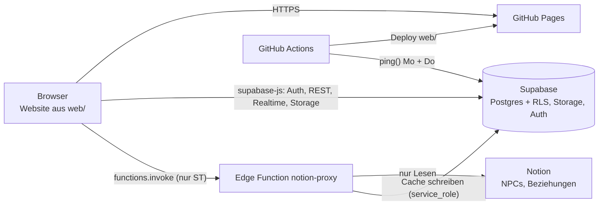

# Kiel by Night · Technische Dokumentation

Stand: 21.10.2026 · gilt für Website-Version 1.3.0 (siehe `CHANGELOG.md`)

Dieses Dokument ist ein **lebendes Dokument**. Es wird bei jeder Änderung an Funktionen, Rechten, Datenbank, Edge Function oder Betrieb mitgepflegt. Jede Änderung steht unten in der Änderungsliste. Die Bedienung beschreibt das [Benutzerhandbuch](Benutzerhandbuch.md).

## 1. Überblick

Chronik-Website für die VTM-V5-Chronik „Kiel by Night“. Es gibt zwei Rollen: **Storyteller (ST)** und **Spieler**. Die Seite ist statisch (kein Build-Schritt) und läuft auf GitHub Pages. Login, Daten, Dateien und Realtime liefert Supabase. Die NPCs und Beziehungen der Chronik liegen in Notion und werden nur für den ST über eine Edge Function gelesen.



| Baustein | Wert |
|---|---|
| Website | https://luciusgr.github.io/kiel-by-night/ |
| Repository (öffentlich) | https://github.com/LuciusGR/kiel-by-night (Branch `main`) |
| Supabase-Projekt | Ref `ueiqslwzpjzfpexiwtbb`, Region eu-central-1 (Frankfurt), Free-Plan |
| Supabase-URL | https://ueiqslwzpjzfpexiwtbb.supabase.co |
| Edge Function | `/functions/v1/notion-proxy` |
| Bibliotheken (CDN jsDelivr) | cytoscape 3.33.1 (Script-Tag), @supabase/supabase-js 2.45.4 (ESM-Import in `core.js`) |
| Schriften | Google Fonts (Alegreya Sans, IBM Plex Mono, Libre Caslon Display) |

## 2. Repository-Aufbau

```
web/                         Frontend ohne Build-Schritt
  index.html                 Rahmen, lädt cytoscape und js/app.js
  css/theme.css              Design (hell/dunkel per Variablen)
  js/config.js               Supabase-URL und öffentlicher Key (kein Geheimnis)
  js/app.js                  Start, Anmeldung, Navigation, Theme, Passwort-Dialog
  js/core.js                 Supabase-Client, Zustand S, Router (go/render), Profile/Charaktere laden
  js/lib.js                  DOM-Helfer h(), Toast, Fehlermeldungen, guard(), Datumsformate
  js/views/*.js              ein Modul pro Bereich (siehe Abschnitt 4)
supabase/migrations/         Schema, Rechte, Storage, Startdaten und spätere Änderungen
supabase/functions/notion-proxy/index.ts   Edge Function
supabase/config.toml         verify_jwt = false für notion-proxy
.github/workflows/           pages.yml (Deploy), keepalive.yml (Ping)
docs/                        Setup-Anleitung (versioniert), Review v1.0, diese Doku, Benutzerhandbuch
tests/                       RLS-Tests, Function-Test, Browser-Smoke-Test
```

## 3. Konten und Anmeldung

- **Selbstregistrierung ist aus** (Supabase: *Authentication → Sign In / Providers → Allow new users to sign up* = aus). Nur der Anbieter *Email* ist aktiv. Konten legt der ST im Dashboard an.
- **Benutzername statt E-Mail:** Supabase Auth braucht eine E-Mail als Kennung. Die Website zeigt ein Feld „Benutzername“ und macht daraus intern `name@kbn.invalid` (`toLoginEmail` in `app.js`, `.invalid` kann nie eine echte Adresse sein, es werden keine Mails verschickt). Erlaubt sind 2 bis 32 Zeichen: Kleinbuchstaben, Zahlen, Punkt, Minus, Unterstrich. Eine eingetippte Adresse mit `@` geht unverändert durch (alte Konten).
- **Mitgliedschaft = Profil.** Ein Konto ohne Eintrag in `public.profiles` sieht nichts (alle Policies verlangen `is_member()`). Profile entstehen **nicht** automatisch.
- **Konto anlegen:** Dashboard → *Authentication → Users → Add user → Create new user*. E-Mail `benutzername@kbn.invalid`, Passwort, **Auto Confirm User** anhaken. Danach im SQL-Editor das Profil anlegen:
  ```sql
  insert into public.profiles (id, display_name, role) values ('<UID des Kontos>', 'Anzeigename', 'player');
  update public.characters set owner_id = '<UID>' where clan = '<Clan>';
  ```
- **Adresse eines Kontos ändern:** Das Dashboard bietet das nicht an. Per SQL `auth.users.email` und `auth.identities.identity_data->>'email'` gemeinsam ändern (`provider_id` ist die Konto-ID und bleibt).
- **Passwort:** Jede Person ändert es selbst in der Kopfzeile („Passwort“). Eine Passwort-vergessen-Mail gibt es nicht (Pseudo-Adressen). Vergessen: Konto im Dashboard löschen und neu anlegen (UID ändert sich, Profil und Charakter-Zuordnung neu setzen) oder Passwort per SQL setzen (nicht getestet).
- **Aktuelle Konten:** `storyteller` (Roland, Rolle st), `lukas` (Tremere), `johana` (Ventrue). Damien Dark (Malkavian) folgt, sein Charakter hat noch keinen Besitzer.

## 4. Frontend

Reine ES-Module ohne Bundler. Alle Texte kommen als Textknoten in den DOM (`h()` in `lib.js`), nirgends `innerHTML` mit Nutzerdaten. Einzige Ausnahme ist die feste SVG-Legende der Formen in `map.js`.

### 4.1 Start und Router
- `app.js` prüft `config.js`, holt die Sitzung, lädt Profile und Charaktere und ruft `go(view)`. Ohne Sitzung erscheint das Login-Formular. Ohne Profil erscheint „Für dieses Konto gibt es kein Profil“.
- `core.js` hält den Zustand `S` (Nutzer, `isST`, Profile, Charaktere, aktuelle Ansicht, Aufräumfunktionen). `go()` ruft zuerst alle Aufräumfunktionen (zum Beispiel ausstehende Speicherungen) und rendert dann die Ansicht. Der Hash (`#chars`, `#map` …) wird mit `replaceState` gesetzt: **keine Zurück-Taste, keine Tiefen-Links**.
- Gültige Ansichten: `start`, `chars`, `sessions`, `map`, `wiki`, `docs`, `private` (nur Spieler), `st` (nur ST).

### 4.2 Ansichten (`web/js/views/`)

| Datei | Bereich | Wichtiges |
|---|---|---|
| `overview.js` | Übersicht | Charakterkarten, „Letzte Änderungen“ aus Wiki, Dokumenten, Session-Notizen (RLS blendet Verstecktes aus) |
| `characters.js` | Charaktere | V5-Bogen als ein JSON-Dokument (`characters.sheet`). **Modi Ansicht (Standard) und Bearbeitung**. Autospeichern 800 ms nach der letzten Eingabe, beim Zurückschalten oder Verlassen sofort |
| `sessions.js` | Sessions | Eine Seite pro Session, jede Person schreibt einen eigenen Abschnitt. Titel und Spieldatum in `sessions` |
| `private.js` | Privat | Private Notizen (Spieler); der ST liest sie im Storyteller-Bereich |
| `playermap.js` | Spielerkarte | gemeinsame Karte (Knoten, Kanten, Positionen), Realtime für Knoten und Kanten |
| `map.js` | Kartenansicht | von Spielerkarte und ST-Karte genutzt (Cytoscape) |
| `storyteller.js` | Storyteller | Beziehungskarte aus Notion (nur lesend) und private Spielernotizen |
| `wiki.js` | Wiki | Kategorien, Tags, Verweise `[[Seitentitel]]` |
| `docs.js` | Dokumente | Upload und Öffnen über signierte URLs |

### 4.3 Charakterbogen
- JSON-Felder: `attr` (9 Attribute 1–5), `skills` (je `{v, spec}`), `disc` (`[{name, lvl, powers}]`), `health` und `wp` (Arrays 0/1/2 = leer/oberflächlich/schwer), `hunger`, `humanity`, `stains`, `bp`, `xpTotal`, `xpSpent` und Textfelder (concept, ambition, desire, predator, sire, generation, resonance, touchstones, advantages, notes). Health = Stamina + 3, Willpower = Composure + Resolve. `normSheet()` ergänzt fehlende Felder.
- `name` und `clan` liegen als eigene Spalten. Gespeichert wird immer der ganze Bogen (**der letzte Speicherstand gewinnt**).
- Bearbeiten dürfen Besitzer und ST. Ohne Recht gibt es nur die Ansicht ohne Umschalter.
- Zahlenfelder (Blood Potency, XP) zeichnen den Bogen nicht neu, nur „XP frei“ wird nachgeführt.

### 4.4 Karten (`map.js`)
- `MapView(root, src)` bekommt eine Quelle `src` (Laden, Speichern der Positionen, optional Schreibfunktionen und Realtime). Die **Spielerkarte** ist bearbeitbar, die **ST-Karte** schreibgeschützt (Daten aus Notion).
- **Modi Ansicht (Standard) und Bearbeitung** nur bei bearbeitbaren Karten. In der Ansicht sind Anlegen, Bearbeiten, Löschen, Verschieben (`autoungrabify`) und „Neu anordnen“ gesperrt. Suche, Filter und Auswählen bleiben. Die Suche zeigt alle Treffer als Liste aus `<details>`-Einträgen im Seitenfeld, zugeklappt bei mehr als einem Treffer, offen bei genau einem (`resultsView()`).
- Cytoscape wird mit `layout: preset` gestartet. Sonst legt die Bibliothek ein Raster über die gespeicherten Positionen. Fehlende Positionen werden zufällig im sichtbaren Bereich gesetzt, die Erstanordnung (Cose-Layout) wird gespeichert.
- Positionen: Tabelle `map_positions` (scope `player` oder `st`, Schlüssel = Knoten-ID bzw. Notion-ID ohne Bindestriche oder `lbl:<Text>`). Schreiben gebündelt 700 ms nach dem Ziehen, Rest beim Verlassen der Ansicht. Andere sehen Positionsänderungen erst nach Neuladen.
- ST-Karte: Form je Sekte (Camarilla Sechseck, Anarch Dreieck, Sabbat Raute, Unabhängig abgerundetes Rechteck, Second Inquisition Stern, sonst Kreis), Farbe je Wesen, Tote abgedunkelt, Spielercharakter mit Doppelring. „Auf Spielerkarte“ legt nur Name und Typ an (keine Beschreibung, keine Tags), bei Verbindungen ohne Beschriftung.

### 4.5 Dokumente
- Privater Bucket `documents`, Pfad `<uploader-uuid>/<zufall>-<bereinigter-name>`. Erlaubt: PDF, PNG, JPEG, WEBP, GIF, TXT, Markdown, höchstens 20 MB (Bucket-Limit und Prüfung im Browser). `documents` führt Titel, Beschreibung, Pfad, Größe, `draft` und Uploader. Öffnen über signierte URL (1 Stunde), Bildvorschau ebenso.

### 4.6 Sonstiges
- Theme hell/dunkel/automatisch (`data-theme`, gemerkt in `localStorage` `kbn-theme`).
- Fehlertexte aus PostgREST-Codes in `lib.js` (`errMsg`), Rückfragen vor Löschen (`confirmBtn`).

## 5. Datenbank (Supabase Postgres)

| Tabelle | Inhalt |
|---|---|
| `profiles` | `id` (= Auth-Konto), `display_name`, `role` (`st` oder `player`) |
| `characters` | `owner_id`, `name`, `clan`, `sheet` (jsonb), `sort` |
| `sessions` | `number` (Schlüssel), `title`, `play_date` |
| `session_notes` | `session_number`, `author_id`, `body` |
| `private_notes` | `owner_id`, `title`, `body` |
| `wiki_categories` | `name`, `sort`, `st_only`, `created_by` |
| `wiki_pages` | `category_id`, `title`, `tags`, `body`, `created_by` (unveränderlich), `updated_by` |
| `documents` | Metadaten zu Dateien im Bucket, `draft` |
| `player_map_nodes` | `label` (eindeutig ohne Groß/Klein), `type`, `tags`, `description`, `is_pc`, `character_id` |
| `player_map_edges` | `from_node`, `to_node`, `label`, `direction` (directed, mutual, undirected), `description` |
| `map_positions` | `scope`, `node_key`, `x`, `y` |
| `notion_cache` | genau eine Zeile (`id = 1`): `payload` (jsonb) und `fetched_at` |

**Funktionen** (alle `security definer` mit festem `search_path`): `is_st()`, `is_member()`, `wiki_category_visible(uuid)`, `ping()` (liefert `ok:<Anzahl Profile>`, für den Keepalive). **Trigger:** `touch_updated` (`updated_at`), `wiki_touch` (hält `created_by` unveränderlich), `profiles_guard` (nur der ST ändert Rollen, nicht die eigene). **Realtime:** nur `player_map_nodes` und `player_map_edges`.

### Migrationen (in dieser Reihenfolge anwenden, nie ändern, Änderungen kommen als neue Datei)

| Datei | Inhalt |
|---|---|
| `20261020120000_schema_v1_0.sql` | Tabellen, Hilfsfunktionen, Trigger |
| `20261020120100_rls_v1_0.sql` | GRANTs, RLS, Policies, Realtime |
| `20261020120200_storage_v1_0.sql` | Bucket `documents` und Datei-Policies |
| `20261020120300_seed_v1_0.sql` | 3 Charaktere, Spielerkarten-Knoten, Wiki-Kategorien |
| `20261020120400_notion_cache_service_role_v1_0.sql` | `service_role` darf `notion_cache` schreiben |
| `20261021120000_st_admin_v1_1.sql` | Storyteller als Administrator |

Anwenden: Supabase-Dashboard → *SQL Editor* (jede Datei ganz einfügen, Run) oder `npx supabase db push`. Der SQL-Editor führt ein Skript als eine Transaktion aus.

## 6. Rechte

Grundsatz: `anon` darf nichts außer `ping()`. `authenticated` bekommt Tabellenrechte, RLS schränkt je Zeile ein. **Mitglied** = hat ein Profil, **ST** = `role = 'st'`.

| Daten | Lesen | Schreiben |
|---|---|---|
| `profiles` | Mitglieder | Anzeigename: jede Person selbst. ST: Anzeigename und Rolle aller (nicht die eigene Rolle), Profile anlegen und löschen (nicht das eigene) |
| `characters` | Mitglieder | Besitzer und ST ändern; ST legt an und löscht |
| `sessions` | Mitglieder | Mitglieder; Löschen ST |
| `session_notes` | Mitglieder | eigene; ST alle (auch im Namen anderer anlegen) |
| `private_notes` | Besitzer und ST | Besitzer; ST alle |
| `wiki_categories` | Mitglieder (`st_only` nur ST) | Mitglieder legen an (nicht `st_only`); umbenennen und löschen nur ST |
| `wiki_pages` | je Kategorie sichtbar | in sichtbaren Kategorien anlegen und ändern; löschen Ersteller und ST |
| `documents` | Mitglieder (Entwürfe nur ST) | anlegen Mitglieder (Entwurf nur ST); ändern (freigeben) ST; löschen Uploader und ST |
| `player_map_*` | Mitglieder | Mitglieder (auch Löschen von Spielercharakter-Knoten) |
| `map_positions` | `player`: Mitglieder, `st`: ST | wie Lesen |
| `notion_cache` | ST | ST direkt, die Edge Function über `service_role` |
| Storage `documents` | eigener Ordner, ST alles, Mitglieder: Dateien zu freigegebenen Dokumenten | hochladen: eigener Ordner (ST jeder Ordner); löschen: eigener Ordner und ST |

Wichtig: Die Spalte `role` ist per Spalten-GRANT änderbar. Der Trigger `profiles_guard` lässt Änderungen nur dem ST zu (nicht an der eigenen Rolle). Ohne ihn könnte ein Spieler sich selbst zum ST machen. Der Trigger greift nicht im SQL-Editor und bei `service_role` (`auth.uid()` ist leer).

## 7. Edge Function `notion-proxy`

Datei `supabase/functions/notion-proxy/index.ts`, `verify_jwt = false` (Gateway prüft nicht, die Function prüft selbst).

- **Aufruf:** `POST` mit `Authorization: Bearer <JWT des Nutzers>`, Body `{"refresh": true|false}`. Im Browser: `sb.functions.invoke("notion-proxy", { body: { refresh } })`.
- **Ablauf:** (1) Nutzer per `auth.getUser()` prüfen, (2) `is_st()` prüfen, sonst 403, (3) ohne `refresh` den Cache (`notion_cache.id = 1`) liefern, sonst (4) NPCs und Beziehungen aus Notion lesen, (5) Cache mit `service_role` speichern, (6) Antwort `{ npcs, rels, fetched_at, source: "cache"|"notion", warning? }`. Fällt Notion aus, liefert sie den Cache mit `warning`.
- **Fehler:** 401 `unauthorized`, 403 `forbidden`, 405 `method_not_allowed`, 500 `config_missing` / `role_check_failed` / `notion_token_missing`, 502 `notion_failed`.
- **Notion:** Datenquellen NPCs `43d92643-5cc1-44f9-b12b-8977a87767f4` (Datenbank `8b4c5c76db7b4d4db57c7bdc32c652c8`) und Beziehungen `51381fc5-6079-4b3d-bfe7-94a65ead1c6d` (Datenbank `484bef7b8d764db9b1447c06987ea3c8`), überschreibbar per Secret. API `POST /data_sources/{id}/query` (Version 2025-09-03), bei 400/404 Rückfall auf `POST /databases/{id}/query` (2022-06-28). 100 Zeilen pro Seite, 350 ms Pause, bis zu 5 Versuche bei 429/5xx (Retry-After). Es wird **nur gelesen**.
- **Feldzuordnung NPC:** Name, Map-Label (`label`), Map-Tags (`tags`, Trenner `\|`), Notizen (`<br>` wird Zeilenumbruch), Fraktion, Generation/Rang, Clan, Clan/Sekte, Sekte (Form), Status (`Tot` = abgedunkelt), Kategorie, Wesen (Typ und Farbe). **Beziehungen:** Beziehung (Titel), Von, Nach, Von (NPC), Nach (NPC), Beschreibung, Richtung (gerichtet, wechselseitig, ungerichtet). Endpunkte ohne Relation werden über das Label gesucht, sonst entsteht ein Platzhalter-Knoten `lbl:<Text>` („Ohne NPC-Eintrag“).
- **CORS:** erlaubt nur die Herkunft aus dem Secret `ALLOWED_ORIGIN` (`https://luciusgr.github.io`). Ohne das Secret gilt `*`.

## 8. Konfiguration und Secrets (nur Fundorte, keine Werte)

| Wo | Was |
|---|---|
| `web/js/config.js` | `SUPABASE_URL` und `SUPABASE_ANON_KEY` (öffentlicher Publishable-Key, darf im Repo stehen) |
| Supabase → Edge Functions → Secrets | `NOTION_TOKEN` (Notion-Integration, nur Lesen), `ALLOWED_ORIGIN`. `SUPABASE_URL`, `SUPABASE_ANON_KEY`, `SUPABASE_SERVICE_ROLE_KEY` stellt Supabase automatisch bereit. Optional: `NOTION_NPC_SOURCE`, `NOTION_NPC_DB`, `NOTION_REL_SOURCE`, `NOTION_REL_DB` |
| Supabase → Edge Functions → notion-proxy → Settings | „Verify JWT with legacy secret“ **aus** |
| GitHub → Settings → Secrets and variables → Actions | `SUPABASE_URL`, `SUPABASE_ANON_KEY` (für den Keepalive) |
| GitHub → Settings → Pages | Source: GitHub Actions |
| Notion → Entwicklertools → Verbindungen | Verbindung „Kiel by Night“: nur „Inhalt lesen“, Zugriff auf die Seite „Kiel by Night“ samt Unterseiten |

Niemals den `service_role`- oder `secret`-Schlüssel ins Repo oder in den Browser schreiben.

## 9. Betrieb

- **Deploy:** Jeder Push auf `main`, der `web/**` oder `pages.yml` ändert, startet `pages.yml` und veröffentlicht den Ordner `web/` (Dauer etwa eine Minute). Browser-Cache zwingt ggf. zu Strg+F5.
- **Keepalive:** `keepalive.yml` ruft montags und donnerstags (05:23 UTC) `POST /rest/v1/rpc/ping` auf, damit Supabase das Free-Projekt nicht nach 7 Tagen pausiert. Manuell startbar (Actions → Run workflow). GitHub deaktiviert geplante Workflows nach 60 Tagen ohne Repo-Aktivität, dann in *Actions* wieder einschalten.
- **Notion pflegen:** Änderungen in den Datenbanken NPCs und Beziehungen erscheinen nach „Aus Notion neu laden“ auf der ST-Karte. Neue Felder müssen in `index.ts` (Zuordnung) und `storyteller.js` (`buildGraph`) ergänzt werden.
- **Datenänderungen per SQL** im SQL-Editor, immer mit Blick auf die Profile und Fremdschlüssel (Löschen eines Profils löscht dessen Notizen und Dokument-Einträge).
- **Sicherung:** Im Free-Plan gibt es keine automatische Wiederherstellung (nicht geprüft). Wichtige Inhalte regelmäßig exportieren.

## 10. Tests

| Test | Aufruf | Prüft |
|---|---|---|
| RLS | `tests/run_tests.sh` (PostgreSQL 16 mit Nachbau von auth/storage, `tests/mock_supabase.sql`) | Rechte aller Rollen |
| Edge Function | `deno run --allow-net --allow-env --allow-read --allow-sys tests/notion_proxy_test.ts` | Ablauf mit gespieltem Notion und Supabase |
| Browser-Smoke | `cd tests/browser && npm install && npm test` | alle Bereiche, beide Rollen, hell und dunkel (Attrappe von Supabase ohne RLS) |

Der umfangreiche UAT liegt im Repo unter `tests/uat` (Rechte: 167 Fälle auf PGlite, Edge Function: 24 Fälle, Browser: 131 Fälle, Stand 21.10.2026: 130 grün, bekannt U155b). Aufruf und Voraussetzungen stehen in `tests/uat/README.md`. Der Bericht dazu liegt beim Skill `kiel-by-night-website`.

## 11. Bekannte Einschränkungen

- Letzter Speicherstand gewinnt bei gleichzeitigem Bearbeiten (Bogen, Wiki, Notizen).
- Keine Zurück-Taste und keine Tiefen-Links; ein geöffneter Bogen ist nach Neuladen wieder die Liste.
- Schließt man den Tab in den 800 ms nach der letzten Eingabe, kann die Änderung fehlen.
- Alle Mitglieder dürfen Spielerkarten-Knoten löschen, auch Spielercharakter-Knoten.
- Schriften von Google Fonts, Skripte von jsDelivr ohne Integritätsprüfung, keine Content-Security-Policy (GitHub Pages setzt keine Header).
- Die Oberfläche bietet dem ST noch kein Bearbeiten und Löschen fremder Notizen und keine Rollen- oder Profilverwaltung (die Rechte bestehen in der Datenbank).
- Badge-Kontrast im Dunkelmodus knapp unter 4,5:1.

## 12. Doku pflegen

Bei jeder Änderung an Funktionen, Rechten, Datenbank, Function, Konfiguration oder Betrieb diese Doku **und** das Benutzerhandbuch anpassen, die Änderung unten eintragen und im `CHANGELOG.md` erwähnen. Schema-Änderungen kommen immer als neue Migration, Setup-Anleitung und Review sind versionierte Schnappschüsse (`_vX_Y`).

## 13. Änderungen an dieser Doku

- **21.10.2026 (Version 1.4):** Kartensuche in `map.js`: `searchIds()` liefert alle Treffer (Label, Alias), `applySearch()` markiert sie, `resultsView()` zeigt je Treffer ein `<details>`, offen nur bei genau einem Treffer. Zustand `resultsOn`, endet beim Antippen eines Knotens. UAT-Skripte liegen jetzt in `tests/uat`.
- **21.10.2026 (Version 1.3):** Erste Fassung. Stand: Login mit Benutzernamen, Modi Ansicht und Bearbeitung, Kartenfix, ST als Administrator.
